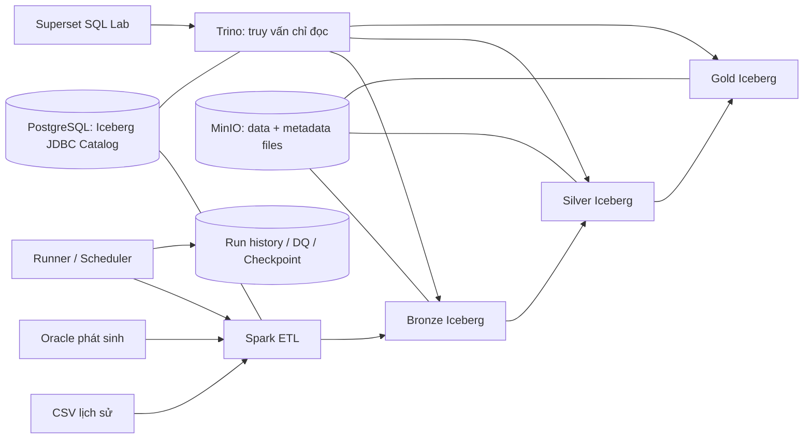

# Đề cương học và thực hành Lakehouse On-Premise trong 30 ngày

**Nhóm:** 3 Fresher, bắt đầu từ số 0.  
**Vai trò:** Data Platform (bạn), Data Engineer, DataOps.  
**Ngày lập:** 09/11/2026. Ngày 1–30 được tính từ ngày nhóm thực sự bắt đầu.  
**Phạm vi:** CSV + Oracle → Spark → Iceberg Bronze/Silver/Gold trên MinIO → Trino → Superset SQL Lab. Không làm dashboard.

## 1. Mục tiêu, giả định và cách sử dụng đề cương

Mục tiêu là hoàn thành 100% yêu cầu được ghi trong đề, kiểm chứng bằng kết quả có thể tái hiện và chuẩn bị tốt cả sáu nhóm tiêu chí. Không thể bảo đảm trước điểm tuyệt đối vì đề chưa có trọng số, thang điểm chi tiết và câu hỏi vấn đáp. Tài liệu này dùng “100%” để chỉ độ phủ yêu cầu và việc vượt qua các điều kiện nghiệm thu đã định nghĩa, không phải cam kết điểm số.

### 1.1. Điều kiện để kế hoạch khả thi

- Mỗi người bố trí khoảng 24 giờ/tuần, tương đương khoảng 100 giờ/người trong một tháng. Có thể chia 6 buổi × 4 giờ/tuần; các ngày dành cho tổng kết và dự phòng nhẹ hơn.
- Có một máy dùng chung hoặc máy lab truy cập được bởi cả nhóm. Một môi trường Linux thống nhất giúp giảm lỗi khác biệt máy cá nhân.
- Ước lượng ban đầu: RAM 32 GB, khoảng 8 luồng CPU, SSD trống 100 GB nếu chạy cả Oracle. Đây là ngân sách lập kế hoạch, phải đo lại sau khi dựng thử, không phải thông số tối thiểu do nhà cung cấp công bố.
- Nếu chỉ có RAM 16 GB: dùng Oracle được cấp ở máy khác nếu có; giới hạn bộ nhớ từng dịch vụ, chạy Spark theo đợt, giảm dữ liệu. Kiểm chứng tài nguyên trong ngày 1–4 trước khi chốt phạm vi.
- Dùng dữ liệu giả lập, có đáp án kiểm chứng. Nhóm cần xác nhận lựa chọn Superset chưa trùng nhóm khác theo quy định lớp.
- Oracle thật phải được kiểm chứng trong tuần 1. CSV không thay thế yêu cầu nguồn Oracle.

### 1.2. Quy tắc làm việc

1. Mỗi task có đúng một owner; người review không trở thành đồng owner.
2. Học phần sắp dùng, thực hành ngay, ghi lại điều đã hiểu và bằng chứng.
3. Không chờ học hết Linux/Python/SQL rồi mới bắt đầu project.
4. Sau mỗi ngày: cập nhật task board, một commit hoặc lý do chưa commit, kết quả kiểm tra và blocker.
5. Sau mỗi tuần: demo, review bằng chứng và thực hành chéo. Không nghiệm thu bằng lời nói.
6. Lỗi quá 60–90 phút chưa tìm được nguyên nhân: ghi lỗi, giả thuyết, lệnh đã thử, nhờ người review; không đổi hàng loạt cấu hình cùng lúc.
7. Dành tuần cuối để kiểm chứng và bàn giao. Tính năng chưa cần thiết không chen vào giai đoạn này.

Một buổi 4 giờ tham khảo: 45 phút học, 150 phút làm, 30 phút kiểm tra/tài liệu, 15 phút trao đổi nhóm. Đây là cách phân bổ, không phải thêm thời gian ngoài ngân sách.

## 2. Ma trận yêu cầu chính thức và bằng chứng

Các mã R01–R10 do nhóm đặt để theo dõi, giữ nguyên ý nghĩa các hạng mục trong đề.

| Mã | Yêu cầu của đề | Điều kiện đạt | Bằng chứng |
|---|---|---|---|
| R01 | Infrastructure | Dịch vụ thường trực cần thiết chạy và sẵn sàng; init/job hoàn thành đúng exit code | Trạng thái Compose, healthcheck, smoke test |
| R02 | Object Storage | MinIO có bucket `lakehouse`, lưu được dữ liệu | Kết quả kiểm tra bucket và object |
| R03 | Data Zones | Có Bronze, Silver, Gold, giải thích được mục đích | Namespace, DDL, truy vấn từng tầng |
| R04 | Table Format | Bảng thực sự là Iceberg, không chỉ là thư mục Parquet | DDL, metadata/snapshot và truy vấn từ hai engine |
| R05 | ETL | Spark xử lý CSV và Oracle qua ba tầng | Lệnh chạy, log, báo cáo run thành công |
| R06 | Query | Trino đọc đúng bảng Iceberg | Bộ SQL và kết quả mong đợi/thực tế |
| R07 | Data Quality | Có null, duplicate, completeness; phát hiện được dữ liệu sai chủ đích | Bộ fixture, báo cáo DQ pass/fail |
| R08 | Incremental | Chạy lại không nhân đôi; bổ sung kiểm chứng insert/update tăng dần | So sánh khóa, giá trị, tổng hợp trước/sau |
| R09 | Operations | Có log, phát hiện lỗi và hướng dẫn xử lý | Runbook và kết quả diễn tập |
| R10 | Documentation | Kiến trúc, triển khai, hướng dẫn công cụ mở rộng | Bộ tài liệu và thử nghiệm dựng lại |

Yêu cầu bổ sung xuyên suốt: Superset là công cụ mở rộng đã chọn; mỗi task một owner; cả ba hiểu và thực hành được cả ba mảng.

**Lưu ý R01:** Spark batch job và container khởi tạo bucket có thể kết thúc thành công. Không cần giữ các container này chạy vô hạn để làm đẹp trạng thái.

## 3. Kiến trúc và phạm vi kỹ thuật

### 3.1. Luồng dữ liệu



### 3.2. Quyết định kiến trúc đề xuất

| Thành phần | Quyết định | Lý do và giới hạn |
|---|---|---|
| Triển khai | Docker Compose, một host | Phù hợp bài tập một tháng, dễ tái lập |
| Storage | MinIO, bucket `lakehouse` | Đáp ứng đề, dùng giao thức S3 |
| Catalog | Iceberg JDBC Catalog trên PostgreSQL | Không phải dựng thêm REST server/Hive Metastore |
| ETL | PySpark local mode trong container | Đủ thực hành Spark, giảm chi phí vận hành cụm |
| Bảng | Iceberg format v2, Parquet; ban đầu copy-on-write | Giảm độ phức tạp đọc dữ liệu cập nhật; phải kiểm tra với bộ phiên bản đã chọn |
| Truy vấn | Trino single-node; Iceberg catalog chỉ đọc | Spark là writer chính, giảm xung đột và diện thao tác phá dữ liệu |
| Superset | SQL Lab, truy vấn đồng bộ, giới hạn thời gian/số dòng | Dùng kiểm chứng truy cập SQL, không làm dashboard |
| Điều phối | Python runner + cron của Linux, có khóa chống chạy chồng | Ít thành phần, đủ học orchestration cơ bản |
| Metadata vận hành | PostgreSQL database riêng | Lưu run, step, DQ, manifest, checkpoint |
| Quan sát | Log container + log JSON pipeline + trạng thái run | Đủ chẩn đoán; không thêm stack monitoring riêng |

Iceberg và Trino đều có hỗ trợ JDBC Catalog; cấu hình tên catalog nội bộ, warehouse, thông tin PostgreSQL và phiên bản schema catalog phải thống nhất. [Iceberg JDBC](https://iceberg.apache.org/docs/latest/jdbc/), [Trino metastores](https://trino.io/docs/current/object-storage/metastores.html).

MinIO chứa data files và metadata files của Iceberg; PostgreSQL catalog lưu thông tin đăng ký và tham chiếu metadata. PostgreSQL không thay thế object storage.

Các lệnh `MERGE INTO` bằng Spark SQL cần cấu hình Iceberg Spark extensions theo phiên bản sử dụng. [Iceberg Spark writes](https://iceberg.apache.org/docs/latest/spark-writes/).

### 3.3. Phạm vi Superset

Phải hoàn thành: cài driver Trino trong image, cấu hình connection, chạy SQL Lab, lưu SQL mẫu, kiểm tra quyền ứng dụng, persistence metadata và runbook lỗi kết nối.

Superset cần driver DB-API và SQLAlchemy dialect phù hợp với engine; kiểm tra theo phiên bản đã chốt. [Tài liệu kết nối database](https://superset.apache.org/user-docs/databases/).

Trino được cấu hình Iceberg catalog ở chế độ chỉ đọc để chặn ghi tại engine. Việc tắt DML trên giao diện Superset chỉ là một lớp bổ sung. Chế độ catalog chỉ đọc không chứng minh đã có phân quyền theo từng danh tính, không chặn Spark hoặc truy cập trực tiếp MinIO. [Trino Iceberg security](https://trino.io/docs/current/connector/iceberg.html).

Không nhận thêm dashboard, chart, báo cáo kinh doanh, Celery/Redis hoặc truy vấn bất đồng bộ nếu chức năng bắt buộc không cần chúng. Dùng cấu hình Superset lab tối giản và kiểm chứng trực tiếp; không sao chép toàn bộ stack development nếu gây quá tải.

### 3.4. Những việc để sau khi project đạt nghiệm thu

Kafka/CDC, Kubernetes, HA, multi-node Spark/Trino, OpenMetadata, Grafana/Prometheus, Ranger và data governance đầy đủ là hướng mở rộng, không nằm trong phạm vi cam kết 30 ngày. TLS/authentication Trino hoặc quyền chi tiết theo người dùng chỉ bổ sung khi yêu cầu môi trường cần hoặc còn thời gian sau các kiểm thử chính. Môi trường lab phải giới hạn truy cập; không tuyên bố đạt chuẩn bảo mật production.

## 4. Chuẩn môi trường và điều kiện kỹ thuật

### 4.1. Các dịch vụ và lưu trữ

| Dịch vụ | Lưu bền vững | Kiểm tra sẵn sàng |
|---|---|---|
| MinIO | Volume data | Health endpoint và đọc/ghi object thử |
| PostgreSQL | Volume database | Kết nối được từng database đúng tài khoản |
| Oracle nếu nhóm tự dựng | Volume theo image đã chọn | Kết nối service/PDB đúng, đọc được bảng nguồn |
| Trino | Cấu hình được quản lý trong Git, log theo chính sách | Server sẵn sàng và SQL đọc bảng thành công |
| Superset | Metadata DB, cấu hình và secret key ổn định | Health endpoint, login và truy vấn thực tế |
| Spark batch | Code/config/image; đầu ra trên MinIO | Submit thành công, job exit code đúng, dữ liệu được kiểm tra |
| Runner | Log và run state | Scheduler có heartbeat hoặc dấu lần gọi gần nhất |

Một PostgreSQL instance có thể chứa database tách biệt cho catalog, Superset và operations; dùng user riêng. Không cấp quyền quản trị PostgreSQL cho ứng dụng.

Compose khởi động container không có nghĩa dịch vụ đã sẵn sàng. Dùng healthcheck và điều kiện phụ thuộc phù hợp; runner vẫn cần retry kết nối có giới hạn. [Docker Compose startup order](https://docs.docker.com/compose/how-tos/startup-order/).

### 4.2. Cổng và tên máy

- Lập bảng endpoint: từ host và từ container; dùng service name của Compose giữa các container.
- `localhost` trong container chỉ tới chính container đó.
- Chỉ publish các cổng cần dùng. Truy cập máy lab từ xa bằng mạng nội bộ được kiểm soát hoặc SSH tunnel.
- Nếu dùng Windows + WSL2, thống nhất chạy lệnh dự án trong Linux/WSL; tránh trộn interpreter và đường dẫn giữa hai hệ điều hành.
- Đo RAM/CPU/disk trong một lần chạy thực tế; giới hạn memory của Trino/Spark để còn đủ cho Oracle, PostgreSQL và host.

### 4.3. Chốt phiên bản bằng kiểm chứng

Ngày 4 lập `docs/version-matrix.md`: image tag và digest, Java trong image, Spark, Scala, Iceberg runtime, Iceberg AWS bundle/S3FileIO, PostgreSQL driver, Oracle JDBC driver, Trino, Superset, driver Python Trino. Ghi link tài liệu đúng phiên bản và ngày kiểm tra.

Không đoán một bộ phiên bản chỉ từ tên sản phẩm. Trước khi freeze phải chạy: tạo bảng → insert → merge → Trino đọc → restart → đọc lại. Chốt rõ schema version JDBC catalog, tránh nhầm với format version của bảng Iceberg. Không dùng `latest` trong cấu hình bàn giao.

Driver và dependency cần có sẵn trong image hoặc cache có kiểm soát; pipeline bình thường không phải tải JAR từ Internet mỗi lần chạy. On-Premise không mặc nhiên là air-gapped; nếu có yêu cầu offline thì phải kiểm tra và đóng gói riêng.

## 5. Lộ trình kiến thức tối thiểu

| Chủ đề | Cả ba phải hiểu | Bài thực hành chứng minh | Người học sâu hơn |
|---|---|---|---|
| Terminal/Linux | Đường dẫn, file, quyền cơ bản, process, biến môi trường, exit code | Đọc log và xác định một lệnh thất bại | Platform, Ops |
| Git | Clone, branch, commit, diff, pull, giải quyết xung đột đơn giản | Mỗi người sửa một file, tạo commit và review | Cả ba |
| SQL | SELECT, WHERE, NULL, COUNT, GROUP BY, JOIN, CTE, ROW_NUMBER | Tìm khóa trùng, tính tổng và chọn bản ghi mới nhất | DE |
| Python | Kiểu dữ liệu, list/dict, hàm, file, exception, logging | Đọc CSV, phát hiện bản ghi lỗi, trả exit code | DE, Ops |
| Docker | Image/container, volume, network, healthcheck | Dựng dịch vụ, restart và kiểm tra persistence | Platform |
| Lakehouse | Lake/warehouse, Parquet/Iceberg, catalog/storage/engine | Vẽ và giải thích đường đi một bản ghi | Cả ba |
| Spark | DataFrame, schema, lazy evaluation, transform/action, partition | Đọc CSV/JDBC và ghi Iceberg | DE |
| Iceberg | Snapshot, metadata, commit, merge, time travel | Xem snapshot trước/sau một cập nhật | DE, Platform |
| Trino | Catalog/schema/table, connector, query ID | Đọc cùng bảng Spark vừa ghi | Platform |
| DataOps | Stage, run, retry, idempotency, checkpoint, lock | Gây lỗi rồi chạy lại an toàn | Ops |
| Data Quality | Null, uniqueness, completeness, reconciliation | Fixture sai làm kiểm thử thất bại đúng lý do | DE, Ops |
| Vận hành | Health khác readiness, backup khác volume, RTO/RPO | Khôi phục bản sao sang môi trường thử nghiệm | Ops, Platform |

Các file đào tạo sẵn trong `docs/` có thể dùng bổ trợ: tổng quan Data Platform ở ngày 1; SQL cơ bản và tổng hợp ngày 2–3; Python đọc/kiểm tra/làm sạch dữ liệu ngày 2–3; tư duy dữ liệu nghiệp vụ để chốt grain và công thức ngày 3. Không cần học toàn bộ nội dung nâng cao trước khi triển khai. Các slide Python minh họa pandas giúp học thao tác dữ liệu, nhưng ETL chính của project vẫn phải dùng Spark.

## 6. Phân công và quản lý đầu việc

Ký hiệu **P = Data Platform**, **D = Data Engineer**, **O = DataOps**. Owner của artifact được quy định dưới đây; thay đổi từ người khác cần owner review. Tác vụ hỗ trợ hoặc bài thực hành chéo không làm thay đổi owner.

| Mã | Task / artifact | Owner | Reviewer | Tiêu chí |
|---|---|---|---|---|
| P01 | Kiến trúc, endpoint, tài nguyên, quyết định kỹ thuật | P | D | 1 |
| P02 | Compose, network, healthcheck, thứ tự khởi tạo | P | O | 2 |
| P03 | MinIO, bucket, volume, tài khoản storage | P | O | 1, 2 |
| P04 | PostgreSQL, Iceberg JDBC Catalog, database/user | P | D | 1, 2 |
| P05 | Spark image, JAR, runtime config; Oracle connectivity | P | D | 2, 3 |
| P06 | Trino connector, đọc MinIO, chế độ chỉ đọc | P | O | 2, 4 |
| P07 | Superset image, driver, connection và app role | P | O | 2, 4 |
| P08 | Version matrix, tài liệu triển khai và cấu hình recovery | P | O | 2, 5, 6 |
| D01 | Grain, schema, data contract và công thức Gold | D | P | 1, 3 |
| D02 | Generator dữ liệu, Oracle DDL/seed, đáp án chuẩn | D | O | 3, 4 |
| D03 | CSV/Oracle ingestion, staging và Bronze | D | P | 3 |
| D04 | Chuẩn hóa, reject, deduplicate, Silver merge | D | O | 3, 4 |
| D05 | Gold và SQL nghiệp vụ/đối soát | D | O | 3, 4 |
| D06 | Logic watermark, dữ liệu đến muộn, rerun/backfill | D | O | 3, 5 |
| D07 | Định nghĩa DQ và code kiểm tra trong pipeline | D | O | 4 |
| D08 | Snapshot/schema evolution/maintenance minh họa | D | P | 3, 5 |
| O01 | Task board, workflow Git, bộ khung tài liệu | O | P | 6 |
| O02 | Runner, scheduler, lock và run/step state | O | D | 3, 5 |
| O03 | Schema vận hành, log, DQ report và exit code | O | D | 4, 5 |
| O04 | Bộ kiểm thử tích hợp, đối chiếu đáp án độc lập | O | D | 3, 4 |
| O05 | Script và quy trình backup/restore | O | P | 5 |
| O06 | Runbook, fault injection và recovery drill | O | P | 5 |
| O07 | Hướng dẫn SQL Lab, test persistence và SQL mẫu thực thi | O | D | 4, 6 |
| O08 | Evidence index, checklist release, tổng hợp báo cáo | O | P | 6 |

Quy tắc tránh chồng chéo: P sở hữu môi trường đọc Oracle, D sở hữu bảng/seed và câu truy vấn lấy dữ liệu; D sở hữu quy tắc DQ, O sở hữu việc kiểm chứng quy tắc và báo cáo; P cung cấp thông tin storage/catalog, O sở hữu quy trình backup/restore. Mỗi người viết nội dung kỹ thuật của mình, O tổng hợp và kiểm tra tài liệu.

## 7. Lịch 30 ngày: học → làm → nghiệm thu

Mỗi ngày có tối đa một mục tiêu tích hợp chính. Các phần làm song song chỉ bắt đầu khi dependency đã sẵn sàng. Cột “nghiệm thu” là điều kiện kết thúc ngày, không phải lời hứa rằng mọi phần đã đạt mức hoàn chỉnh.

### Tuần 1 — Bắt đầu từ số 0 và nối được toàn bộ hệ thống

#### Ngày 1 — Hiểu đề, chuẩn bị máy và chia trách nhiệm

- **Học chung:** Data Lakehouse là gì; phân biệt storage, table format, catalog, compute và SQL engine; terminal và Git cơ bản.
- **P:** kiểm tra máy/OS/RAM/disk, Docker/Compose; lập bảng dịch vụ và endpoint dự kiến; ghi cách cả nhóm truy cập máy lab.
- **D:** mô tả một đơn hàng, hai nguồn và sơ đồ ba tầng; tạo 10 dòng dữ liệu dễ tính bằng tay.
- **O:** tạo task board theo R01–R10 và P/D/O; hướng dẫn mỗi người commit vào branch riêng; tạo mẫu evidence.
- **Nghiệm thu:** cả ba dùng được repo, chạy được container thử, giải thích được vai trò sáu thành phần; có một owner cho mỗi task. Kiểm tra Oracle/image và quyền tải ngay hôm nay.

#### Ngày 2 — Nền tảng SQL, Python và Docker

- **Học chung:** SELECT/WHERE/COUNT/GROUP BY/NULL; Python đọc file, hàm, exception; Docker volume/network.
- **P:** dựng MinIO và PostgreSQL trước; kiểm tra dữ liệu vẫn còn sau restart; tạo các database/user riêng.
- **D:** Python đọc CSV nhỏ và chỉ ra lỗi; viết SQL đếm dòng, khóa trùng, tổng tiền với đáp án tự tính.
- **O:** script kiểm tra công cụ, dung lượng và biến cấu hình; thực hành đọc container log, kiểm tra exit code.
- **Nghiệm thu:** không nhầm host/container endpoint; SQL trả kết quả đúng; restart không làm mất object/database thử.

#### Ngày 3 — Data contract và Spark cơ bản

- **Học chung:** schema, kiểu dữ liệu, grain, DECIMAL, timestamp, DataFrame và lazy evaluation.
- **P:** chuẩn bị Spark image cùng dependency Iceberg/PostgreSQL/S3; kiểm tra Java/Scala/runtime; tạo bucket `lakehouse`.
- **D:** chốt contract ở mục 8, seed dữ liệu chuẩn/lỗi; đọc CSV bằng schema rõ ràng; chuẩn bị Oracle DDL/seed.
- **O:** tạo kiểm thử số lượng/khóa/giá trị với fixture nhỏ; tạo cấu trúc log và schema run history.
- **Nghiệm thu:** Spark đọc CSV được; contract có khóa, múi giờ, quy tắc source conflict và đáp án; dependency không tải lại mỗi run.

#### Ngày 4 — Spark ghi Iceberg, Trino đọc

- **Học chung:** catalog, namespace, warehouse, snapshot và commit.
- **P:** cấu hình JDBC Catalog và Trino cùng backend; kiểm tra MinIO endpoint/path-style; chốt bộ phiên bản sau smoke test.
- **D:** tạo bảng Iceberg thử, insert/merge một đơn hàng, xem snapshot; xác định khác biệt kiểu dữ liệu giữa engine nếu có.
- **O:** tự động hóa smoke test tạo/đọc bảng; lưu DDL, kết quả và log cùng commit hash.
- **Nghiệm thu:** Trino đọc đúng dữ liệu Spark vừa cập nhật; restart vẫn đọc được. Nếu chưa đạt thì tập trung sửa tích hợp, chưa mở tính năng mới.

#### Ngày 5 — Kết nối Oracle thật

- **Học chung:** JDBC, hostname/port, service name/PDB, quyền SELECT, updated_at.
- **P:** kiểm tra Oracle sẵn sàng, JDBC driver và tài khoản đọc nguồn; không dùng tài khoản quản trị làm tài khoản ETL.
- **D:** nạp dữ liệu seed, Spark đọc Oracle bằng JDBC và ghi Bronze thử; kiểm tra NUMBER/DATE/TIMESTAMP thực tế.
- **O:** kiểm thử sai mật khẩu, không kết nối được và truy vấn rỗng; đảm bảo log không lộ credential.
- **Nghiệm thu:** Spark đọc được Oracle và ghi Iceberg, số lượng/khóa/giá trị khớp seed. Lưu cấu hình mẫu không có secret. [Spark JDBC](https://spark.apache.org/docs/latest/sql-data-sources-jdbc.html).

#### Ngày 6 — Luồng ba tầng đầu tiên và Superset SQL Lab

- **Học chung:** Bronze/Silver/Gold và quan hệ Superset → Trino → Iceberg.
- **P:** dựng Superset với metadata PostgreSQL, cài driver Trino, tạo connection; cấu hình Trino catalog chỉ đọc.
- **D:** đưa dữ liệu nhỏ từ cả hai nguồn qua Bronze → Silver → Gold; viết 5 SQL truy vấn/đối soát.
- **O:** runner đầu tiên chạy các bước tuần tự, ghi trạng thái và exit code; kiểm tra SQL Lab chạy được truy vấn đã lưu.
- **Nghiệm thu:** có một luồng end-to-end thật, không cần thao tác copy dữ liệu thủ công giữa các tầng; chưa yêu cầu đầy đủ incremental.

#### Ngày 7 — Demo mốc G1 và thực hành chéo

- **Học chung:** ôn bằng cách giải thích đường đi một bản ghi và một câu SQL.
- **P:** hoàn thiện endpoint/version/deployment notes; D chạy lại kiểm tra hạ tầng theo tài liệu.
- **D:** giải thích schema và pipeline; O chạy job nhỏ và đối soát kết quả.
- **O:** lập báo cáo G1; P thực hiện truy vấn DQ và đọc log run.
- **Nghiệm thu G1:** CSV và Oracle đều đã đọc được; Spark ghi Iceberg; Trino đọc; SQL Lab truy vấn; persistence cơ bản đạt; blocker có owner và thời hạn. Không tính chỉ mở được UI là đạt.

### Tuần 2 — Hoàn thiện ETL, chất lượng và tính đúng đắn

#### Ngày 8 — Tiếp nhận dữ liệu có thể truy vết

- **Học chung:** batch ID khác attempt ID; manifest, source identity và dữ liệu raw.
- **P:** chốt layout object và quyền đọc/ghi từng tài khoản; kiểm tra quota/dung lượng.
- **D:** hoàn thiện CSV/Oracle extraction, staging bất biến và metadata Bronze; triển khai commit lại batch an toàn.
- **O:** tạo run/step/manifest records, lưu source count và checksum nếu phù hợp; phát hiện đầu vào thiếu.
- **Nghiệm thu:** với một dòng Silver có thể tìm về Bronze, source và batch; retry cùng batch không append lại mù quáng.

#### Ngày 9 — Chuẩn hóa kiểu dữ liệu và reject

- **Học chung:** cast lỗi, dữ liệu null, trim, DECIMAL, timestamp và timezone.
- **P:** thống nhất timezone của container/engine, kiểm tra config được truyền vào job.
- **D:** chuẩn hóa field, kiểm tra required/range/enum; lưu rejected row cùng raw value và error code.
- **O:** chạy fixture null/date sai/số âm/status lạ; kiểm chứng từng dòng bị loại đúng lý do.
- **Nghiệm thu:** không cast lỗi rồi âm thầm mất dòng; Silver hợp lệ không còn required null; thống kê raw/reject giải thích được.

#### Ngày 10 — Chọn phiên bản và MERGE Silver

- **Học chung:** ROW_NUMBER, khóa nghiệp vụ, tie-breaker và upsert.
- **P:** kiểm tra SQL extensions, format v2 và copy-on-write thực tế trên bảng.
- **D:** chọn một phiên bản hợp lệ mới nhất theo contract; merge chỉ khi phiên bản hợp lệ mới hơn hoặc có thay đổi được phép; phát hiện conflict không thể phân giải.
- **O:** test duplicate trong cùng nguồn, giữa nguồn, retry và phiên bản cũ; kiểm tra đầy đủ giá trị, không chỉ COUNT.
- **Nghiệm thu:** Silver có tối đa một dòng/order_id; bản ghi cũ không ghi đè bản mới; conflict có cùng thứ tự ưu tiên nhưng payload khác làm batch fail rõ lý do.

#### Ngày 11 — Gold và kiểm chứng độc lập

- **Học chung:** GROUP BY, conditional aggregation, grain tổng hợp, đối soát.
- **P:** kiểm tra quyền truy cập và đọc bảng mới từ Trino; cập nhật catalog notes nếu cần.
- **D:** xây `gold.daily_sales`, tính theo ngày và trạng thái; kiểm tra DataFrame kết quả trước khi publish bảng.
- **O:** đối chiếu bằng bộ expected nhỏ được tính độc lập; viết SQL kiểm tra tổng tiền/số đơn từ Silver lên Gold.
- **Nghiệm thu:** số lượng và giá trị khớp đáp án; đơn CANCELLED không được tính thành doanh thu hợp lệ; chạy lại không cộng dồn tiền lần hai.

#### Ngày 12 — Bộ Data Quality hoàn chỉnh

- **Học chung:** field completeness khác record completeness; severity và quality gate.
- **P:** kiểm tra quyền ghi DQ/report, persistence metadata vận hành.
- **D:** hoàn thiện bộ rule ở mục 10; định nghĩa rõ nguồn nào đếm vào mẫu số và phạm vi từng lần kiểm tra.
- **O:** chạy kiểm thử âm cho mỗi rule; báo cáo expected/actual, mức lỗi, stage và sample không chứa secret.
- **Nghiệm thu:** null/duplicate/completeness đều có test gây fail; thiếu khóa dù tổng COUNT bằng nhau vẫn bị phát hiện bằng đối chiếu tập khóa khi phù hợp.

#### Ngày 13 — Chạy lại và thất bại có chủ đích

- **Học chung:** idempotency, commit từng bảng và retry sau side effect.
- **P:** chuẩn bị môi trường fixture riêng để không ảnh hưởng dữ liệu nghiệm thu.
- **D:** hoàn thiện replay từ staging/Bronze, Gold overwrite nguyên tử một bảng; không tăng watermark khi chưa thành công.
- **O:** gây dừng sau Bronze, sau Silver và sau Gold trước khi ghi success; chạy lại theo runbook, đối chiếu state.
- **Nghiệm thu:** không mất dòng, không nhân đôi, không sai giá trị; run lỗi không được gắn SUCCESS; run đang RUNNING khi process chết được nhận diện và xử lý.

#### Ngày 14 — Demo mốc G2 và đổi vai

- **Học chung:** trình bày quy tắc dữ liệu và failure recovery bằng lời của mình.
- **P:** tự chạy ingestion nhỏ, giải thích reject/merge và đối soát Gold.
- **D:** tự restart Trino/MinIO an toàn, đọc endpoint và xác định một lỗi kết nối.
- **O:** nghiệm thu fixture và dẫn demo một batch lỗi; tổng hợp kết quả G2.
- **Nghiệm thu G2:** pipeline đúng với fixture; DQ bắt được lỗi; rerun không nhân đôi; có log và hướng dẫn chạy. Chưa qua G2 thì cắt phần nâng cao để sửa nền tảng.

### Tuần 3 — Incremental, vận hành và khai thác SQL

#### Ngày 15 — Oracle incremental có biên đọc rõ ràng

- **Học chung:** watermark, lookback, upper bound; giới hạn của timestamp-based incremental.
- **P:** kiểm tra JDBC session/timezone và quyền đọc; giữ việc cập nhật nguồn có kiểm soát trong bài test.
- **D:** implement initial load + incremental theo updated_at; lưu biên đọc trong manifest; hỗ trợ khoảng đọc lặp và upsert.
- **O:** test insert mới, update đơn cũ, timestamp bằng mốc và nguồn không đổi; kiểm tra checkpoint chỉ tiến khi pipeline thành công.
- **Nghiệm thu:** dữ liệu mới/cập nhật được lấy đúng, rerun không nhân đôi; ghi rõ giới hạn về cập nhật backdate và hard delete. Không gọi giải pháp này là CDC/exactly-once end-to-end.

#### Ngày 16 — Lịch chạy và chống chạy chồng

- **Học chung:** scheduler khác runner; lock, timeout, retry và exit code.
- **P:** cấu hình quyền chạy trên host, thư mục log và timezone scheduler.
- **D:** chuẩn hóa tham số `batch_id`, `mode`, khoảng backfill; cung cấp command contract cho runner.
- **O:** hoàn thiện cron + lock một host, step state và retry giới hạn; hai lời gọi đồng thời chỉ có một pipeline được chạy.
- **Nghiệm thu:** scheduler gọi được job không cần terminal; lỗi không bị báo thành công; không retry vô hạn lỗi schema/DQ. Có cách chạy tay cùng cơ chế lock.

#### Ngày 17 — Hoàn thiện Superset SQL Lab

- **Học chung:** connection credentials, app role, engine read-only, query ID.
- **P:** hoàn thiện image/driver, connection, role người dùng lab, secret key ổn định và query limit/timeout phù hợp.
- **D:** chốt 8–10 SQL mẫu: xem ba tầng, reject, duplicate, completeness, đối soát, snapshot.
- **O:** hướng dẫn login/chọn connection/chạy SQL/đọc lỗi; test SELECT thành công, DDL/DML bị Trino từ chối; restart vẫn giữ cấu hình cần thiết.
- **Nghiệm thu:** người không có quyền sửa connection không sửa được connection; SQL Lab dùng được sau restart; không yêu cầu chart/dashboard.

#### Ngày 18 — Log, tài nguyên và quan sát pipeline

- **Học chung:** tương quan run_id/query_id; symptom và nguyên nhân; memory/disk.
- **P:** đo CPU/RAM/disk trong lần chạy thật, kiểm tra memory limit và dung lượng storage; ghi baseline tài nguyên.
- **D:** log input/output/reject counts, thời gian từng stage và snapshot đầu ra; tối ưu một điểm có bằng chứng nếu cần.
- **O:** tổng hợp run history, cảnh báo thất bại qua terminal/file trạng thái; retention/rotation log; cách nhận diện missed schedule.
- **Nghiệm thu:** từ một run_id tìm được bước lỗi, thông điệp và cách chạy lại; không log password/token; log không tăng vô hạn mà không có chính sách.

#### Ngày 19 — Persistence, backup và restore

- **Học chung:** volume không phải backup; catalog backup phải phù hợp object backup; RPO/RTO.
- **P:** xác định volume/bucket/database/secret cần khôi phục; cung cấp config cho môi trường restore riêng.
- **D:** cung cấp bộ kiểm tra bảng, khóa, tổng tiền và snapshot trước/sau restore.
- **O:** dừng writer/scheduler, backup trạng thái nhất quán, restore vào môi trường riêng, chạy kiểm tra và đo thời gian.
- **Nghiệm thu:** Trino truy vấn được dữ liệu đã restore; cấu hình Superset giải mã connection được khi dùng đúng secret key; có RPO theo lịch backup và RTO đo được, không hứa giá trị chưa đo.

#### Ngày 20 — Diễn tập sự cố và phục hồi

- **Học chung:** khoanh vùng network/auth/storage/catalog/application/data.
- **P:** tạo một lỗi endpoint hoặc credential trên lab; kiểm tra service recovery sau restart.
- **D:** tạo một batch data lỗi/conflict và thực hiện sửa dữ liệu bằng quy trình được tài liệu hóa.
- **O:** điều phối drill mất kết nối MinIO/Oracle, dừng Spark giữa run, kiểm tra disk pressure bằng ngưỡng giả lập; ghi incident report.
- **Nghiệm thu:** runbook xử lý được ít nhất 5 nhóm lỗi; không xóa volume hay Iceberg metadata để “sửa nhanh”; khôi phục xong phải đối soát dữ liệu.

#### Ngày 21 — Demo mốc G3

- **Học chung:** sơ đồ phụ thuộc, giới hạn hệ thống và cách mở rộng sau lab.
- **P:** thực hành xử lý lỗi pipeline do O chuẩn bị.
- **D:** kiểm tra SQL Lab/Trino khi bị cấu hình sai và khôi phục theo tài liệu.
- **O:** trình diễn backup/restore đã kiểm chứng; audit evidence và backlog.
- **Nghiệm thu G3:** incremental insert/update, SQL Lab, lịch chạy, lock, log, backup/restore và fault drill đều có kết quả. Chốt danh sách lỗi còn lại trước tuần cuối.

### Tuần 4 — Nâng chất lượng có giới hạn, tái lập và bảo vệ

#### Ngày 22 — Dựng sạch theo tài liệu

- **Học chung:** reproducibility, artifact và config drift.
- **P:** cung cấp bộ triển khai và theo dõi; không âm thầm chỉnh tay để cứu bài test.
- **D:** là người thực hiện dựng sạch theo README trên Compose project/volume thử nghiệm mới; ghi bước thiếu hoặc mơ hồ.
- **O:** lưu transcript thời gian, lỗi, thay đổi bắt buộc; chạy end-to-end acceptance trên môi trường mới.
- **Nghiệm thu:** không phụ thuộc file cá nhân hoặc container cũ; không thay đổi/xóa volume môi trường gốc. Nếu thiếu tài nguyên, dựng theo đợt và bảo toàn môi trường gốc bằng quy trình đã kiểm chứng.

#### Ngày 23 — Hiểu Iceberg và bảo trì bảng

- **Học chung:** snapshot/time travel, small files, compaction, retention; snapshot không thay thế backup.
- **P:** kiểm tra đọc chéo Spark/Trino sau thay đổi; kiểm tra giới hạn quyền bảo trì.
- **D:** trên bảng demo riêng, cập nhật dữ liệu và truy vấn snapshot cũ; minh họa thêm cột nullable. Nếu đã qua G3, tạo small files rồi compact và đo số file trước/sau.
- **O:** kiểm tra dữ liệu không đổi sau compaction; ghi retention proposal. Chỉ diễn tập expire/remove orphan trên bảng thử nếu hiểu điều kiện an toàn.
- **Nghiệm thu:** giải thích được snapshot và schema evolution; không hứa compaction nhanh hơn nếu chưa có đo. [Iceberg maintenance](https://iceberg.apache.org/docs/latest/maintenance/).

#### Ngày 24 — Chạy bộ kiểm thử đầy đủ

- **Học chung:** regression, expected result và bằng chứng có thể tái hiện.
- **P:** sửa lỗi tích hợp/cấu hình; kiểm tra secret không xuất hiện trong file được track.
- **D:** sửa lỗi logic và kiểm tra đáp án không dùng lại chính code ETL để tự xác nhận.
- **O:** chạy T01–T36 ở mục 11, tạo report; không đánh PASS bằng screenshot UI khi test đòi hỏi kết quả dữ liệu.
- **Nghiệm thu:** các test bắt buộc đạt; nếu còn lỗi thì đóng các hạng mục nâng cao và ưu tiên sửa. Bắt đầu freeze tính năng.

#### Ngày 25 — Hoàn thiện tài liệu và bằng chứng

- **Học chung:** cách mô tả quyết định kỹ thuật, giới hạn và kết quả đo.
- **P:** hoàn thiện architecture/deployment/version/resource notes.
- **D:** hoàn thiện contract/pipeline/DQ/incremental/SQL docs.
- **O:** hoàn thiện runbook/test-report/evidence-index; link từng R01–R10 và từng tiêu chí tới artifact.
- **Nghiệm thu:** không có link bằng chứng hỏng, placeholder bắt buộc hoặc bước “tự cấu hình” thiếu hướng dẫn.

#### Ngày 26 — Thi thực hành chéo

- **Học chung:** cả ba tự giải thích, không học thuộc câu trả lời của owner.
- **P:** chạy pipeline, tìm một reject, kiểm chứng merge/rerun và Gold.
- **D:** kiểm tra Docker network/volume/catalog, restart dịch vụ và đọc log kết nối.
- **O:** giải thích bảng Iceberg, chạy SQL đối soát, mô tả incremental và thực hiện recovery.
- **Nghiệm thu:** mỗi người hoàn thành tối thiểu một bài thuộc từng mảng; người quan sát ghi lỗi hiểu biết và nội dung cần ôn.

#### Ngày 27 — Mock demo và vấn đáp

- **Học chung:** trình bày theo bằng chứng, nói rõ phần đã làm và giới hạn.
- **P:** trình bày kiến trúc, persistence và đường truy vấn.
- **D:** trình diễn dữ liệu mới/cập nhật, DQ, snapshot và Gold.
- **O:** trình diễn log, rerun và một sự cố; đo tổng thời gian demo.
- **Nghiệm thu:** demo 15–20 phút, cả ba bị hỏi chéo; xác định thao tác nào dễ lỗi và có phương án phục hồi trung thực.

#### Ngày 28 — Release candidate và nghiệm thu G4

- **Học chung:** release/tag/manifest và thay đổi sau freeze.
- **P:** kiểm tra image/config cuối, backup trước release.
- **D:** kiểm tra seed/expected/SQL đồng nhất với code cuối.
- **O:** chạy kiểm thử trên revision cuối; tạo release manifest gồm commit, image digest, test report và tài liệu.
- **Nghiệm thu G4:** đủ R01–R10; sáu nhóm tiêu chí đều có bằng chứng; không còn lỗi nghiêm trọng; cả ba đạt thực hành chéo. Tag chỉ tạo sau khi kết quả kiểm thử đã gắn đúng revision.

#### Ngày 29 — Dự phòng sửa lỗi

- **Học:** ôn phần còn yếu theo mock interview, không mở chủ đề mới.
- **P/D/O:** mỗi người sửa lỗi theo ownership; O xác định các kiểm thử bị ảnh hưởng.
- **Nghiệm thu:** thay đổi cuối được review và chạy lại các test liên quan; nếu đổi runtime/cấu hình cốt lõi thì chạy lại tích hợp đầy đủ.

#### Ngày 30 — Bàn giao và diễn tập cuối

- **P:** kiểm tra máy lab, tài nguyên, endpoint và khả năng mở các UI cần thiết.
- **D:** chuẩn bị fixture demo và đáp án; tách dữ liệu demo khỏi dữ liệu thử nghiệm gây lỗi.
- **O:** xác nhận backup, log, release revision và tài liệu; chạy preflight, diễn tập kịch bản cuối.
- **Nghiệm thu cuối:** người bất kỳ trong nhóm có thể dẫn luồng; bài demo có dữ liệu thật từ cả hai nguồn; không cần dashboard; mọi tuyên bố chính có bằng chứng.

## 8. Data contract và mô hình dữ liệu

### 8.1. Grain và quy tắc nghiệp vụ

- Một dòng Silver = một đơn hàng; `order_id` là khóa toàn cục của bài tập, thống nhất giữa CSV và Oracle.
- CSV chứa lịch sử; Oracle chứa phát sinh và có thể cập nhật một số đơn cũ.
- Mọi thay đổi nguồn Oracle phải cập nhật `updated_at`. Múi giờ logic thống nhất UTC; ngày dùng tính Gold cũng được xác định theo UTC trong lab.
- Quy tắc ưu tiên: phiên bản có `updated_at` lớn hơn thắng; khi cùng thời điểm, Oracle ưu tiên hơn CSV. Nếu cùng nguồn/cùng thời điểm/cùng khóa mà payload khác thì ghi conflict và chặn publish batch, không chọn ngẫu nhiên.
- Bản ghi mới nhưng không hợp lệ được cách ly; không dùng nó ghi đè phiên bản hợp lệ cũ. Báo cáo phải nêu rõ số order bị giữ phiên bản cũ vì cập nhật lỗi.
- Trạng thái hợp lệ: `NEW`, `PAID`, `SHIPPED`, `CANCELLED`. Doanh thu hợp lệ chỉ gồm `PAID` và `SHIPPED`.
- Dùng một tiền tệ, ví dụ VND; `quantity > 0`, `unit_price >= 0`; tiền dùng DECIMAL, không dùng float. Chốt precision/scale và giới hạn tránh overflow.
- Không xử lý hard delete tự động bằng timestamp watermark. Hủy đơn là chuyển `status=CANCELLED`. Nếu muốn hỗ trợ xóa vật lý sau này cần thêm cơ chế phát hiện/tombstone.

### 8.2. Schema Silver tối thiểu

| Cột | Kiểu logic | Quy tắc |
|---|---|---|
| order_id | STRING | Bắt buộc, duy nhất tại Silver |
| customer_id | STRING | Bắt buộc |
| order_timestamp | TIMESTAMP theo quy ước UTC | Parse được, ngày lấy theo UTC |
| status | STRING | Thuộc enum đã chốt |
| quantity | INT | Số nguyên dương, trong giới hạn contract |
| unit_price | DECIMAL(18,2) | Không âm, trong giới hạn |
| amount | DECIMAL(24,2) | quantity × unit_price, kiểm tra overflow |
| updated_at | TIMESTAMP theo quy ước UTC | Bắt buộc, dùng chọn phiên bản |
| source_system | STRING | CSV hoặc ORACLE |
| batch_id | STRING | Truy vết lần tiếp nhận |
| source_record_id | STRING | Định danh bản ghi nguồn/phiên bản |
| payload_hash | STRING | So sánh payload đã chuẩn hóa theo quy tắc cố định |

Kiểu timestamp thực tế và mapping Oracle–Spark–Trino phải kiểm chứng ở ngày 5, không chỉ dựa vào tên kiểu giống nhau.

### 8.3. Bảng và object layout

| Khu vực | Bảng / object | Mục đích |
|---|---|---|
| Landing/staging | `s3://lakehouse/landing/...`, `staging/<batch_id>/...` | Giữ file gốc hoặc extraction bất biến và manifest; phụ trợ, không thay thế Bronze |
| Bronze | `bronze.orders_csv` | Mỗi bản ghi đầu vào cùng raw fields/payload và metadata |
| Bronze | `bronze.orders_oracle` | Extraction Oracle theo batch cùng metadata |
| Silver | `silver.orders` | Một phiên bản hợp lệ cho mỗi order |
| Silver | `silver.orders_rejected` | Dữ liệu lỗi, mã lỗi, field/raw value và batch |
| Gold | `gold.daily_sales` | Một dòng/ngày/trạng thái: order_count, total_amount, recognized_revenue |
| Operations | PostgreSQL ops DB | Pipeline run, step, DQ, manifest, checkpoint |

Data location của các bảng đặt rõ dưới `s3://lakehouse/bronze/`, `silver/`, `gold/`; namespace không tự bảo đảm object được đặt đúng prefix. Không sửa/xóa tay các file data/metadata của bảng Iceberg.

Bronze nên giữ field dạng raw hoặc raw JSON để dữ liệu sai định dạng còn truy vết được. Bảng reject có thể chứa nhiều mã lỗi cho một dòng nhưng đối soát số dòng phải dựa trên định danh dòng riêng biệt, không đếm số lỗi thành số dòng.

Partition: chỉ dùng phân vùng ngày khi dữ liệu và truy vấn thực sự hưởng lợi; có thể khởi đầu unpartitioned. Nếu chọn phân vùng Silver bằng ngày đơn hàng, phải test cập nhật một bản ghi làm đổi ngày và cách merge xử lý. Không partition theo order_id hoặc tạo partition quá nhỏ chỉ để có cấu hình.

### 8.4. Bộ dữ liệu học và kiểm chứng

1. **Bộ A — đáp án nhỏ:** khoảng 20–50 dòng, có tổng tiền và kết quả từng order tính bằng tay hoặc công cụ độc lập.
2. **Bộ B — tích hợp:** khoảng 1.000 dòng cho vòng phát triển hằng ngày.
3. **Bộ C — quy mô lab:** khoảng 10.000–100.000 dòng tùy tài nguyên; đo thời gian và RAM, không dùng để tuyên bố benchmark doanh nghiệp.
4. **Các batch thay đổi:** insert mới, update đơn cũ, cùng timestamp, dữ liệu muộn trong lookback, dữ liệu quá lookback cần backfill, conflict, tệp đổi nội dung cùng tên, batch rỗng và file thiếu.

Generator có seed cố định. Fixture sai dữ liệu phải cố ý, có manifest chỉ rõ expected behavior; bảng nguồn thực hành có thể cho phép một số giá trị xấu để học DQ. Không nới lỏng production source trong một hệ thống thật.

## 9. Pipeline, incremental và chạy lại an toàn

### 9.1. Các bước xử lý

```text
PREFLIGHT → LOCK → CREATE/RESUME BATCH
→ EXTRACT + IMMUTABLE STAGING + MANIFEST
→ BRONZE → VALIDATE/NORMALIZE → SILVER
→ BUILD AND VALIDATE GOLD CANDIDATE → PUBLISH GOLD
→ RECORD OUTPUT SNAPSHOTS → COMMIT CHECKPOINT + SUCCESS → RELEASE LOCK
```

- `batch_id` định danh dữ liệu logic của một lần tiếp nhận; `attempt_id` định danh một lần thử chạy. Retry batch giữ batch_id và tăng attempt_id.
- Manifest lưu tệp/hash, biên query Oracle, số dòng extraction, version contract, vị trí staging và trạng thái từng nguồn. Staging chỉ được dùng khi extraction đã được xác nhận đầy đủ.
- CSV dùng hash nội dung và định danh dòng ổn định; không dùng tên file làm định danh duy nhất. Fixture quy định CSV không có multiline field nếu parser dùng số dòng; nếu mở rộng parser phải định nghĩa lại record identity.
- Với Oracle, extraction của batch được materialize vào staging bất biến trước khi xử lý lại. Không đọc lại nguồn đang thay đổi rồi vẫn gọi đó là cùng một đầu vào.
- Bronze ghi theo batch bằng một thao tác thay thế phạm vi batch hoặc MERGE có khóa bản ghi nguồn đã định nghĩa; không dùng “DELETE rồi APPEND” hai commit để giả định nguyên tử.
- Silver chọn một bản ghi nguồn cho mỗi order trước MERGE; kiểm tra conflict và chỉ update khi cần. Với lượng dữ liệu nhỏ, có thể đọc toàn bộ Bronze để chọn phiên bản mới nhất; ghi rõ chi phí tăng theo lịch sử và hướng tối ưu sau lab.
- Gold có một bảng chính, dựng lại đầy đủ từ Silver. Kiểm tra candidate trước khi thay thế bảng bằng thao tác Iceberg nguyên tử phù hợp đã thử nghiệm; không cộng dồn tổng của batch vào tổng hiện có.
- `COMMIT CHECKPOINT + SUCCESS` dùng transaction trong ops DB. Nếu pipeline chết trước bước này, retry batch và đối chiếu lại, không bỏ qua dữ liệu vì một bảng đã commit.

Iceberg commit nguyên tử theo bảng, không tạo transaction chung cho Bronze, Silver, Gold và ops DB. Trong khi pipeline đang chạy, các tầng có thể ở các thời điểm khác nhau. Người dùng SQL Lab xem last_successful_run và snapshot tương ứng; không tuyên bố có atomic publication toàn bộ nhiều bảng. Trong bài demo, chỉ nghiệm thu dữ liệu sau quality gate và run thành công.

### 9.2. Oracle incremental

Initial load đọc toàn bộ dữ liệu trong fixture. Sau đó dùng cửa sổ:

```text
updated_at >= last_successful_watermark - lookback
AND updated_at <= upper_bound_cua_batch
```

Biên cụ thể có thể dùng khoảng nửa mở nếu nhóm thiết kế như vậy, nhưng phải nhất quán, lưu vào manifest và có test boundary. Đọc lặp là có chủ đích, upsert xử lý phần trùng.

- Chỉ tiến watermark sau khi pipeline thành công; nguồn rỗng hoặc lỗi không tự động được coi là thành công.
- Giả định bài lab: updated_at phản ánh thay đổi, không bị backdate tùy ý; khi đối soát count/keys nguồn phải dùng cùng extraction hoặc cùng snapshot/SCN nếu đã triển khai nhất quán nguồn.
- Trong test nhỏ, tạm ngừng cập nhật nguồn ở thời điểm lấy manifest để dễ kiểm chứng. Nếu không có consistent snapshot thì ghi rõ hạn chế đối soát với nguồn đang thay đổi.
- Dữ liệu quá lookback cần lệnh backfill theo khoảng thời gian, không âm thầm bỏ qua rồi tuyên bố đầy đủ.
- Cập nhật được commit muộn, timestamp không đáng tin hoặc hard delete cần thiết kế mạnh hơn; timestamp watermark không giải quyết tổng quát các trường hợp này.
- `order_id > max_id` chỉ bắt insert tăng khóa, không đủ cho cập nhật đơn cũ.

### 9.3. State và logging tối thiểu

| Đối tượng | Trường quan trọng |
|---|---|
| pipeline_run | run_id, batch_id, attempt_id, mode, status, start/end, code_version, error_code |
| pipeline_step | run_id, step_name, status, start/end, input/output/reject counts, snapshot_id |
| ingestion_manifest | batch_id, source, source identities/hash, window, staged_count, staged_path, status |
| dq_result | run_id, rule_id, scope, severity, expected, actual, pass/fail |
| checkpoint | source, successful_watermark, successful_batch_id |

State tham khảo: PENDING → RUNNING → SUCCESS hoặc FAILED. Runner bị kill có thể để RUNNING; preflight cần nhận diện run bị bỏ dở bằng lock/process/heartbeat và cho resume có kiểm soát. Không tự chạy song song để “cứu” run cũ.

## 10. Chất lượng dữ liệu và đối soát

### 10.1. Danh mục rule

| Mã | Rule | Phạm vi | Cách xử lý |
|---|---|---|---|
| Q01 | Required null/blank | order_id, customer_id, thời gian bắt buộc | Reject dòng; đếm distinct source record |
| Q02 | Parse/type | Ngày, số, precision/overflow | Reject và giữ raw value |
| Q03 | Domain/range | Quantity, price, enum status | Reject dòng |
| Q04 | Duplicate input | Cùng record/version, cùng business key | Ghi metric; áp dụng chọn phiên bản, không che lỗi |
| Q05 | Uniqueness Silver | COUNT mỗi order_id = 1 | Fail pipeline nếu vi phạm |
| Q06 | Extract completeness | Tập record/key và count extraction so với manifest nguồn cùng phạm vi | Fail nếu mất/thiếu/đổi bất thường |
| Q07 | Bronze completeness | Staging đã hoàn tất so với Bronze cùng batch | Fail nếu thiếu, thừa hoặc payload không khớp |
| Q08 | Classification reconciliation | Mọi record Bronze thuộc một loại xử lý có giải thích | Fail nếu có dòng biến mất |
| Q09 | Silver correctness | Tập order hợp lệ và phiên bản thắng so với rule | Fail nếu thiếu/thừa/sai phiên bản |
| Q10 | Gold reconciliation | COUNT và SUM so với Silver cùng quy tắc | Fail trước publish candidate |
| Q11 | Rerun invariance | Khóa và cột nghiệp vụ trước/sau | Fail nếu cùng input làm đổi kết quả nghiệp vụ |
| Q12 | Freshness/run completion | Last success theo lịch kỳ vọng | Báo trạng thái chậm/lỗi; ngưỡng dựa lịch thực tế |

### 10.2. Định nghĩa completeness không mơ hồ

Trong từng phạm vi đối soát, phân loại mỗi source record một lần:

```text
Bronze records
= invalid records
+ valid records được chọn làm phiên bản thắng
+ valid records bị thay thế hoặc bản sao trùng
```

Khi nhiều batch có cùng order, phải ghi rõ đối soát đang xét một batch hay toàn bộ lịch sử. Một order có nhiều raw records nhưng chỉ một dòng Silver, vì vậy không yêu cầu COUNT Bronze = COUNT Silver.

- Null rate là field completeness; chưa đủ chứng minh không mất bản ghi.
- Count giống nhau vẫn có thể sai tập khóa. Với fixture, đối chiếu cả key set bằng anti-join/EXCEPT và các cột nghiệp vụ.
- Oracle source count chỉ so với cùng predicate/snapshot hoặc manifest extraction đã chốt, không so tùy tiện với bảng nguồn đang thay đổi.
- Hash tổng nếu có chỉ là kiểm tra bổ sung; không thay thế so sánh trực tiếp với bộ đáp án nhỏ.

### 10.3. Chính sách quality gate

- Fixture lỗi có chủ đích: số reject và mã lỗi phải đúng đáp án; batch có thể thành công theo chính sách cho phép reject đã ghi rõ.
- Lỗi schema, conflict không phân giải, thiếu đầu vào, mất bản ghi, uniqueness Silver hoặc đối soát Gold: fail, không tiến checkpoint.
- Production-like sample chưa biết lỗi: định nghĩa ngưỡng reject trước khi chạy; không đổi ngưỡng chỉ để report xanh. Ngưỡng là quyết định của nhóm, không phải con số được đề bài quy định.
- Thông báo lỗi phải phân biệt dữ liệu sai với lỗi kết nối/hạ tầng để retry đúng loại.

## 11. Bộ kiểm thử nghiệm thu T01–T36

Đây là bộ mục tiêu chất lượng nội bộ, không phải danh sách do giảng viên ban hành. O sở hữu test harness và report; P/D sửa lỗi theo ownership. Chạy test ngay khi có chức năng, không dồn toàn bộ việc kiểm thử vào ngày 24.

Mỗi test lưu input/fixture version, bước chạy, expected, actual, PASS/FAIL, thời gian, commit, image/config version và đường dẫn log. Test phải có assertion rõ ràng; screenshot chỉ là bằng chứng bổ sung.

| Mã | Tình huống | Điều kiện PASS | Chủ phần bị kiểm tra |
|---|---|---|---|
| T01 | Preflight | Phát hiện thiếu biến cấu hình, thiếu dung lượng hoặc dịch vụ chưa sẵn sàng trước ETL | P |
| T02 | Infrastructure startup | Dịch vụ thường trực ready; init/job kết thúc đúng; không nhầm running với ready | P |
| T03 | MinIO bucket | Có lakehouse, đọc/ghi object thử thành công bằng tài khoản phù hợp | P |
| T04 | Catalog thống nhất | Spark và Trino thấy cùng bảng/location/snapshot tương ứng, không phải hai catalog tách biệt | P |
| T05 | Iceberg thật | Có metadata/snapshot, Spark ghi và Trino đọc được; schema/DDL xác nhận format | P |
| T06 | Nguồn Oracle | JDBC đọc đúng service/bảng và dataset seed; sai mật khẩu trả lỗi rõ | P |
| T07 | CSV ingestion | Tệp chuẩn và tệp cùng tên đổi nội dung được nhận biết đúng; retry không nhân bản raw records | D |
| T08 | Mapping Oracle | Khóa, số tiền, timestamp khớp seed qua Oracle → Spark → Trino | D |
| T09 | Null/blank | Đúng dòng và field bị reject; required Silver không null | D |
| T10 | Parse/type/overflow | Ngày sai, số sai, vượt precision bị bắt; raw value còn truy vết | D |
| T11 | Range/enum | Quantity không hợp lệ, giá âm, status lạ bị bắt theo contract | D |
| T12 | Duplicate/version | Trùng trong nguồn và giữa nguồn được đếm, chọn đúng phiên bản | D |
| T13 | Conflict | Cùng khóa/thứ tự ưu tiên nhưng payload khác không bị chọn ngẫu nhiên; batch fail | D |
| T14 | Mất record | Bỏ có chủ đích một bản ghi ở staging/Bronze trên fixture làm completeness fail | D |
| T15 | Count bằng, key sai | Thay một key bằng key khác vẫn bị phát hiện dù COUNT không đổi | D |
| T16 | Phân loại Bronze | Mọi raw record thuộc đúng một nhóm xử lý; không lẫn số lỗi với số dòng | D |
| T17 | Silver correctness | Đúng tập order/phiên bản/payload, một dòng mỗi order; bản cũ không ghi đè mới | D |
| T18 | Gold correctness | COUNT/SUM/revenue từng ngày/trạng thái khớp expected độc lập và Silver | D |
| T19 | Rerun không đổi | Cùng input chạy lại 2–3 lần: tập khóa và cột nghiệp vụ Silver/Gold không đổi | D |
| T20 | Insert incremental | Chỉ thêm đúng đơn mới, dữ liệu cũ không sai; checkpoint đúng | D |
| T21 | Update incremental | Đơn cũ đổi giá/status cập nhật đúng; Gold không cộng thêm như đơn mới | D |
| T22 | Boundary watermark | Bản ghi đúng tại mốc và đọc lặp không bị mất/nhân đôi | D |
| T23 | Late data/backfill | Trong lookback xử lý được; quá lookback được lấy lại bằng backfill có kiểm chứng | D |
| T24 | Kill sau từng commit | Kill sau Bronze/Silver/Gold rồi retry: dữ liệu đúng, không mất và không nhân đôi | D |
| T25 | Checkpoint/run state | Fail không tiến checkpoint; kill không tạo success giả; resume xử lý state bỏ dở | O |
| T26 | Scheduler/lock | Chạy theo lịch được, chạy tay được; gọi đồng thời chỉ một pipeline giữ lock | O |
| T27 | Superset SQL Lab | Login, connection/SQL mẫu cần thiết tồn tại sau restart; SELECT ra đúng kết quả | P |
| T28 | Engine chỉ đọc | SELECT thành công; thao tác CREATE/INSERT/DELETE trên đối tượng thử bị Trino từ chối, cả qua SQL Lab và client trực tiếp | P |
| T29 | Persistence | Restart/recreate container không xóa volume: bảng, dữ liệu và metadata ứng dụng còn dùng được | P |
| T30 | Restore riêng | Restore catalog + object + config/secret phù hợp sang môi trường thử; dữ liệu và SQL Lab hoạt động | O |
| T31 | Lỗi kết nối | MinIO/Oracle/Trino không sẵn sàng: lỗi được khoanh vùng, retry/dừng đúng chính sách, recovery đối soát lại | O |
| T32 | Log/exit/secret | Run/step trace được; exit code phản ánh lỗi; không có secret trong log/Git; có retention | O |
| T33 | Dựng sạch | Người khác theo tài liệu dựng từ đầu, không cần dữ liệu/file ẩn của owner | P |
| T34 | Thực hành chéo | Mỗi người hoàn thành bài thuộc P, D, O; có 9 kết quả quan sát tổng cộng | O |
| T35 | Snapshot/schema evolution | Truy vấn được dữ liệu cũ theo snapshot trên bảng demo; thêm nullable column không làm engine đọc sai | D |
| T36 | Tài nguyên/quy mô lab | Chạy bộ C trong giới hạn tài nguyên; ghi thời gian, RAM, file count và hạn chế; không OOM | P |

### 11.1. Nguyên tắc đánh giá rerun

So sánh tập khóa và toàn bộ cột nghiệp vụ theo thứ tự chuẩn hoặc bằng đối chiếu hai chiều. Không đòi snapshot ID, attempt ID, log timestamp và metadata vận hành giữ nguyên. Snapshot mới không tự có nghĩa dữ liệu bị nhân đôi. Tuy nhiên tránh MERGE cập nhật vô ích khi payload không đổi.

### 11.2. Bằng chứng restore

Backup chứa catalog DB, object data và metadata Iceberg cùng thời điểm nhất quán, ops DB, Superset metadata, cấu hình và secret cần thiết được lưu an toàn. Writer/scheduler dừng trong lúc tạo bản sao lab. Không coi copy riêng data files hoặc dump riêng catalog là backup đầy đủ của Lakehouse.

Restore sang Compose project/volume riêng, không ghi đè môi trường chính để chứng minh bài test. Ghi số bảng, count, tập khóa, tổng tiền, snapshot có thể truy cập và thời gian khôi phục. Kiểm tra cả SQL Lab nếu tuyên bố đã backup toàn bộ nền tảng.

### 11.3. Phạm vi kiểm thử cuối kỳ

Ngày 24 tổng hợp toàn bộ test, chỉ chạy lại những test chưa có bằng chứng hợp lệ hoặc bị ảnh hưởng bởi thay đổi. Ngày 28 xác nhận bằng chứng khớp release revision; chạy smoke/end-to-end cuối và các regression cần thiết. Không đổi code/config âm thầm sau report. Thay đổi runtime/cấu hình tích hợp đòi hỏi kiểm tra tích hợp rộng hơn.

## 12. Runbook và diễn tập vận hành

### 12.1. Mẫu một runbook

```text
Tên sự cố / mã lỗi:
Triệu chứng và tác động:
Điều kiện phát hiện:
Owner xử lý chính:
Lệnh kiểm tra theo thứ tự:
Nguyên nhân thường gặp:
Hành động khôi phục:
Điểm nào phải dừng writer hoặc scheduler:
Cách chạy lại / backfill:
SQL và kiểm tra sau khôi phục:
Khi nào cần chuyển người phụ trách khác:
Link incident/test evidence:
```

### 12.2. Các runbook tối thiểu

| Sự cố | Kiểm tra đầu tiên | Hướng khôi phục | Xác nhận sau khôi phục |
|---|---|---|---|
| MinIO không truy cập được | Health, endpoint, network, credential, disk | Sửa đúng nguyên nhân; không reset data volume | Đọc object và truy vấn bảng; retry batch |
| Catalog PostgreSQL lỗi | DB health, database/user, network, schema version | Khôi phục kết nối hoặc restore phù hợp object backup | Spark/Trino thấy đúng bảng |
| Oracle JDBC lỗi | Service/PDB, listener, user, driver và quyền đọc | Sửa endpoint/quyền/driver; retry extraction chưa hoàn thành | Count/keys khớp phạm vi đọc |
| Spark thiếu class | Runtime/JAR/Scala/Java và image revision | Dùng image đã chốt; không thêm ngẫu nhiên nhiều JAR | Smoke insert/merge/read lại |
| Spark bị kill/OOM | Run state, memory, input size, stage đã commit | Sửa tài nguyên/logic; resume batch từ input bất biến | T24/T25 và đối soát |
| Trino đọc lỗi bảng | Catalog, S3 endpoint, quyền, type/file support | Sửa cấu hình; dùng SQL chẩn đoán; không sửa metadata JSON bằng tay | SQL từ client và SQL Lab |
| DQ thất bại | Rule ID, expected/actual, raw records, contract | Sửa dữ liệu nguồn hoặc logic có review; rerun/backfill | DQ pass đúng lý do, không bỏ qua rule |
| Superset connection lỗi | Driver, URI, network tới Trino, credential | Sửa image/config/connection; kiểm tra metadata secret | Login và SQL mẫu |
| Scheduler bỏ lịch/chạy chồng | Timezone, cron, lock, process/run state | Sửa lịch/quyền; xử lý stale state có bằng chứng | Một run duy nhất chạy thành công |
| Dung lượng thấp | Volume usage, object/file/log growth | Dọn log theo policy; maintenance có điều kiện; tăng dung lượng | Không xóa file Iceberg trực tiếp |

### 12.3. Bảo trì Iceberg ở mức lab

- Hiểu snapshot retention ảnh hưởng time travel và rollback.
- Compaction thực hiện trên bảng demo sau khi phần bắt buộc ổn; đối chiếu dữ liệu và số file trước/sau.
- Không chạy expire snapshots/remove orphan với retention rất ngắn trong lúc writer đang hoạt động.
- Không xóa backup hoặc snapshot dùng trong kịch bản demo trước khi nghiệm thu.
- Một snapshot rollback chỉ sửa một bảng; không tự khôi phục checkpoint và các bảng phụ thuộc. Nếu demo rollback, dùng bảng riêng hoặc có kế hoạch đồng bộ lại toàn luồng.

Các thao tác maintenance phải theo tài liệu phiên bản đã pin. [Iceberg maintenance](https://iceberg.apache.org/docs/latest/maintenance/).

## 13. Sáu nhóm tiêu chí: làm gì để đạt tốt

Các mức “đủ/tốt” bên dưới là định hướng tự kiểm của nhóm, không phải thang điểm chính thức.

| Nhóm tiêu chí | Mức đáp ứng đủ | Mức chất lượng mục tiêu | Bằng chứng chính |
|---|---|---|---|
| 1. Thiết kế kiến trúc và Data Zones | Có sơ đồ và ba tầng | Giải thích catalog/storage/engine; location rõ; grain/quy tắc/lựa chọn và giới hạn nhất quán | Architecture, ADR, contract, R02–R04, T04/T05 |
| 2. Docker và cấu hình dịch vụ | Các dịch vụ cần thiết chạy được | Ready đúng; persistence; dependency/image pin; credential tách; dựng sạch và tài nguyên đo được | Compose, version matrix, deployment, T01–T06/T27–T29/T33/T36 |
| 3. Spark / Iceberg | Pipeline từ CSV và Oracle tới Gold chạy | Schema rõ, xử lý update, rerun/late data, input traceability, snapshot và evolution | Code, manifests, ETL docs, T07/T08/T12/T13/T17–T25/T35 |
| 4. Truy vấn và DQ | Trino query, null/duplicate/completeness | Golden fixture độc lập, count/key/value reconciliation, quality gate và SQL Lab usable | SQL, Q01–Q12, T09–T19/T27/T28 |
| 5. Vận hành, troubleshooting | Có log và hướng dẫn lỗi | Scheduler/lock, trace run, retry, backup restore đã diễn tập, không skip lỗi | Runbook, incident records, T24–T26/T29–T32 |
| 6. Tài liệu, báo cáo và vấn đáp | Có tài liệu cơ bản | Người khác dựng được; evidence có revision; cả ba làm chéo và giải thích giới hạn | README, test report, role matrix, T33/T34, mock interview |

### 13.1. Các lỗi dễ mất điểm cần chủ động tránh

1. Có ba folder nhưng không có bảng và quy tắc xử lý ba tầng.
2. Có Parquet trên MinIO nhưng không chứng minh Iceberg metadata/catalog hoạt động.
3. Chỉ demo CSV, Oracle chưa đọc thật.
4. Chạy lại dùng append rồi tăng dữ liệu; Gold cộng dồn lại tổng cũ.
5. Kiểm tra duplicate bằng COUNT toàn bảng, không kiểm tra business key.
6. Gọi kiểm tra null là đầy đủ cho completeness.
7. Mất record nhưng vẫn report success; pipeline lỗi mà exit code 0.
8. Sửa bằng tay không có trong README hoặc bí mật thay đổi version sau test.
9. Nói backup nhưng chưa restore; nói có quyền chỉ đọc nhưng chỉ ẩn nút trên UI.
10. Mỗi người chỉ giải thích được phần mình phụ trách; không biết catalog hoặc checkpoint ảnh hưởng gì.
11. Gọi timestamp incremental là CDC đầy đủ hoặc gọi transaction theo bảng là transaction toàn pipeline.
12. Tuyên bố production-ready/benchmark nhanh mà không có đo và giới hạn.

## 14. Tổ chức repository và bộ tài liệu bàn giao

```text
lakehouse-project/
├── README.md
├── compose.yaml
├── .env.example
├── .gitignore
├── infra/
│   ├── spark/                  # Dockerfile, pinned dependencies, runtime config
│   ├── trino/                  # server/catalog/read-only config
│   ├── minio/                  # bucket/account initialization
│   ├── postgres/               # database/user initialization
│   ├── oracle/                 # source deployment config nếu tự dựng
│   └── superset/               # image, driver, app config
├── jobs/
│   ├── ingest_csv.py
│   ├── ingest_oracle.py
│   ├── bronze_to_silver.py
│   ├── silver_to_gold.py
│   └── quality_checks.py
├── orchestration/
│   ├── runner.py
│   └── cron.example
├── scripts/
│   ├── preflight.sh
│   ├── bootstrap.sh
│   ├── smoke-test.sh
│   ├── backup.sh
│   └── restore.sh
├── sql/
│   ├── source/                 # Oracle DDL/seed
│   ├── ops/                    # run/manifest/checkpoint/DQ schema
│   ├── ddl/
│   ├── reconciliation/
│   └── sql-lab/
├── data/
│   ├── sample/                 # fixture nhỏ, dữ liệu giả
│   └── expected/               # đáp án độc lập
├── tests/
│   ├── smoke/
│   ├── integration/
│   └── recovery/
└── docs/
    ├── architecture.md
    ├── decisions.md
    ├── version-matrix.md
    ├── responsibilities.md
    ├── deployment.md
    ├── data-contract.md
    ├── pipeline.md
    ├── data-quality.md
    ├── operations.md
    ├── backup-restore.md
    ├── superset-sql-lab.md
    ├── test-report.md
    ├── evidence-index.md
    └── demo.md
```

Đây là cấu trúc mục tiêu, không bắt buộc tách file nhỏ đúng hệt nếu làm giảm khả năng đọc. Hiện tại tài liệu đề cương không có nghĩa các code/artifact này đã được xây dựng.

### 14.1. Checklist nội dung tài liệu

| Tài liệu | Nội dung bắt buộc |
|---|---|
| README | Bài toán, điều kiện máy, quickstart, luồng demo, link chi tiết |
| Architecture/decisions | Sơ đồ, data flow/control flow, vì sao chọn giải pháp, giới hạn single-host |
| Deployment/version | Dependency, endpoint, env, volume, init, secret setup, start/stop/restart và version pin |
| Contract/pipeline | Grain, keys, schema, source priority, date/money, merge, incremental, backfill, checkpoint |
| DQ | Rule, phạm vi, severity, expected data, reject và quality gate |
| Operations/runbook | Run/resume, lịch chạy, lock, log, sự cố, recovery và post-check |
| Backup/restore | Phạm vi, điểm nhất quán, quy trình, môi trường restore, RPO/RTO đo được |
| Superset SQL Lab | Driver/connection, role, thao tác SQL, saved queries, timeout, troubleshooting |
| Test report | T01–T36, dữ liệu, kết quả thực, lỗi còn lại, revision và link evidence |
| Responsibilities | Task owner, reviewer, nhật ký thực hành chéo |
| Demo/evidence index | Kịch bản, SQL, fixtures, mapping R01–R10/sáu tiêu chí tới bằng chứng |

Không commit `.env`, mật khẩu, access key, token, DB dump có secret hoặc backup thực vào Git. `.env.example` chỉ chứa tên biến và giá trị mẫu không nhạy cảm. Secret phục hồi lưu riêng có kiểm soát, không bỏ quên chỉ vì không nằm trong repo.

### 14.2. Các giao diện lệnh nhóm cần chuẩn hóa

Đây là command contract đề xuất, phải được triển khai thành script/CLI thật; không phải các lệnh đã sẵn có:

```text
preflight
bootstrap
run --batch-id <id> --mode initial|incremental
resume --batch-id <id>
backfill --from <time> --to <time>
status --run-id <id>
verify --suite smoke|integration|recovery
backup --destination <path>
restore --backup <path> --target-project <isolated-project>
```

Mọi lệnh thay đổi dữ liệu cần log và exit code đúng. `resume`/`backfill` dùng cùng lock/policy với lịch chạy, không tạo lối đi tắt bỏ quality gate.

### 14.3. Mẫu evidence

```text
Evidence ID: EV-T21-001
Requirement / criterion: R08 / nhóm 3,4,5
Test: T21 - cập nhật đơn cũ
Owner artifact: D
Người thực hiện test: O
Revision / images / config version:
Input fixture / batch / attempt:
Bước chạy:
Expected:
Actual:
Kết luận: PASS hoặc FAIL
SQL / run_id / snapshot_id / log / timestamp:
Giới hạn hoặc lưu ý:
```

## 15. Thực hành chéo và ngân hàng vấn đáp

### 15.1. Bài thi thực hành nội bộ

| Người | Bài Platform | Bài Data Engineer | Bài DataOps |
|---|---|---|---|
| P | Dựng/kiểm tra catalog và storage | Chạy pipeline, đọc reject, đối soát Gold | Tìm run lỗi, resume và giải thích checkpoint |
| D | Chẩn đoán endpoint/volume/Trino config | Giải thích và sửa lỗi merge trên fixture | Chạy backup/restore theo runbook có người giám sát |
| O | Kiểm tra Spark/Trino dùng chung catalog | Viết SQL uniqueness/completeness, giải thích phiên bản thắng | Xử lý scheduler/lock/run bị bỏ dở |

Owner artifact vẫn chịu trách nhiệm thay đổi chính thức. Mục đích bài thi là đo hiểu biết và khả năng thực hành của người khác, không chuyển ownership.

### 15.2. Câu hỏi cả ba phải trả lời được

1. Một bản ghi từ CSV/Oracle tới Gold đi qua những bước nào?
2. MinIO, Parquet, Iceberg và Catalog đảm nhiệm những phần nào?
3. Vì sao Spark ghi được nhưng Trino có thể không thấy bảng?
4. Catalog mất nhưng object còn thì hệ thống bị ảnh hưởng gì?
5. Vì sao có Spark vẫn dùng Trino?
6. Vì sao Bronze và Silver có số dòng khác nhau mà vẫn đầy đủ?
7. Phân biệt null completeness với record completeness?
8. Khóa nào chống trùng? Cùng order có nhiều version thì chọn thế nào?
9. MERGE đầu vào còn nhiều dòng cùng khóa có rủi ro gì?
10. Retry sau khi Bronze/Silver đã commit làm thế nào để đúng?
11. Nếu Gold đã publish nhưng process chết trước checkpoint thì sao?
12. Vì sao checkpoint chỉ tăng sau khi thành công?
13. Watermark timestamp bỏ sót trường hợp nào, backfill xử lý ra sao?
14. Oracle hard delete có được bắt không? Vì sao?
15. Chạy lại có snapshot mới có phải nhân đôi dữ liệu không?
16. Trino chỉ đọc có chặn Spark hoặc người có MinIO key không?
17. Superset SQL Lab đóng góp gì khi không có dashboard?
18. Docker volume khác backup ở điểm nào?
19. Vì sao restore catalog phải phù hợp object data/metadata?
20. Runbook nào dùng khi SQL Lab lỗi nhưng Trino client vẫn chạy?
21. Tại sao single-host không bảo đảm HA? Tài nguyên nào đang giới hạn lab?
22. Nếu chuyển production, ba việc ưu tiên tiếp theo là gì và vì sao?

Câu trả lời đạt yêu cầu cần chỉ ra artifact hoặc kết quả thực tế của nhóm, không chỉ lặp định nghĩa.

## 16. Kịch bản demo 15–20 phút

| Thời lượng | Nội dung | Người dẫn chính |
|---|---|---|
| 2 phút | Kiến trúc, source, catalog/storage/compute và ownership | P |
| 2 phút | Readiness, bucket, version, volume và đường truy cập | P |
| 4 phút | Chạy batch nhỏ CSV/Oracle qua ba tầng, giải thích run/step | D |
| 3 phút | SQL Lab truy vấn, DQ/reject/completeness và đối soát | D |
| 3 phút | Rerun; thêm đơn/cập nhật đơn, chứng minh không nhân đôi | D + O hỗ trợ thao tác |
| 3 phút | Gây một lỗi đã chuẩn bị trên môi trường demo, khôi phục và post-check | O |
| 2 phút | Bằng chứng restore, dựng sạch, giới hạn và hướng mở rộng | O |

Thao tác có thể dài như restore toàn hệ thống trình bày bằng transcript/video/report đã ghi và mở kết quả restore thực tế nếu có thời gian; nói rõ đó là bằng chứng từ lần diễn tập trước. Không trình bày một kết quả cũ như đang chạy trực tiếp.

Chuẩn bị fixture demo có seed cố định, lệnh reset phạm vi demo an toàn, SQL trước/sau và output kỳ vọng. Không reset volume chính hoặc xóa dữ liệu Iceberg bằng tay trong demo. Nếu có lỗi bất ngờ, dùng log/runbook để chẩn đoán thay vì bỏ qua.

## 17. Definition of Done và điều kiện nộp bài

### 17.1. Checklist cuối cùng

- [ ] R01–R10 có kết quả PASS với evidence khớp release.
- [ ] CSV và Oracle đều được kiểm chứng thực tế.
- [ ] Bronze, Silver, Gold là bảng Iceberg, data/metadata được lưu trên MinIO.
- [ ] Spark ETL và Trino query cho kết quả đúng với golden fixture.
- [ ] Null, duplicate, completeness có cả test tốt và test gây lỗi.
- [ ] Rerun, insert/update, boundary, late data/backfill và crash recovery đã kiểm chứng.
- [ ] Trino catalog chỉ đọc; SQL Lab hoạt động, cấu hình cần thiết tồn tại sau restart.
- [ ] Có scheduler, lock, run/step history, log và checkpoint rõ ràng.
- [ ] Backup đã được restore và đối soát trên môi trường riêng.
- [ ] Người khác dựng sạch từ tài liệu được.
- [ ] Mỗi thành viên đạt bài thực hành ở cả ba mảng.
- [ ] T01–T36 có kết quả và lý giải; nếu còn test chưa đạt thì không tuyên bố hoàn thành 100% bộ mục tiêu nội bộ.
- [ ] Sáu nhóm tiêu chí có artifact và bằng chứng rõ ràng.
- [ ] Repo không chứa secret; biết secret/config phục hồi được lưu ở đâu.
- [ ] Không còn lỗi gây mất/sai/trùng dữ liệu, không báo success giả, không mất dữ liệu sau thao tác restart thông thường.
- [ ] Kịch bản demo được chạy thử ở revision cuối; tài liệu phản ánh đúng hệ thống.

### 17.2. Các mốc quyết định phạm vi

| Mốc | Điều kiện | Nếu chưa đạt |
|---|---|---|
| G1, ngày 7 | Luồng xuyên suốt và Oracle kết nối thật | Tập trung tích hợp; chưa làm tối ưu/maintenance |
| G2, ngày 14 | Dữ liệu đúng, DQ và rerun ổn | Cắt nâng cao; sửa correctness trước incremental tối ưu |
| G3, ngày 21 | Incremental, SQL Lab và vận hành có bằng chứng | Ưu tiên recovery/tài liệu; bỏ demo compaction và phần thêm |
| G4, ngày 28 | Checklist nghiệm thu đạt, release evidence nhất quán | Dùng ngày 29–30 sửa lỗi; ghi trung thực phần chưa đạt |

Các phần có thể giảm trước: quy mô dữ liệu lớn, tối ưu hiệu năng, compaction demo, quyền chi tiết theo người dùng, CI nâng cao. Không cắt CSV/Oracle, ba tầng, Iceberg, Spark, Trino, MinIO, công cụ mở rộng, DQ, rerun và tài liệu vận hành để đổi lấy tính năng mới.

## 18. Tài liệu chính thức để học đúng thời điểm

Các URL latest/current thay đổi theo thời gian. Khi chốt phiên bản, lưu thêm link tương ứng phiên bản trong version matrix. Chỉ đọc phần phục vụ bài thực hành của ngày đó.

| Thời điểm | Nguồn chính thức | Phần cần tập trung |
|---|---|---|
| Ngày 1–2 | [Docker Get started](https://docs.docker.com/get-started/) | Image, container, volume, network, Compose |
| Ngày 2–3 | [Python Tutorial](https://docs.python.org/3/tutorial/) | Data structures, function, module, exception, file |
| Ngày 3–4 | [Spark Quick Start](https://spark.apache.org/docs/latest/quick-start.html) | DataFrame và action/transform cơ bản |
| Ngày 3–5 | [Iceberg Spark getting started](https://iceberg.apache.org/docs/latest/spark-getting-started/) | Catalog, extensions, tạo và truy vấn bảng |
| Ngày 4 | [Iceberg JDBC Catalog](https://iceberg.apache.org/docs/latest/jdbc/) | PostgreSQL backend và Spark config |
| Ngày 4 | [Trino metastores](https://trino.io/docs/current/object-storage/metastores.html) | JDBC catalog name/schema version/warehouse |
| Ngày 4 | [Trino S3 support](https://trino.io/docs/current/connector/hive-s3.html) | Native S3, endpoint và storage tương thích |
| Ngày 5 | [Spark JDBC](https://spark.apache.org/docs/latest/sql-data-sources-jdbc.html) | JDBC options và mapping Oracle |
| Ngày 6,17 | [Superset databases](https://superset.apache.org/user-docs/databases/) | Driver, dialect và connection |
| Ngày 10,13 | [Iceberg Spark writes](https://iceberg.apache.org/docs/latest/spark-writes/) | MERGE, overwrite và atomic write |
| Ngày 16 | [Docker startup order](https://docs.docker.com/compose/how-tos/startup-order/) | service_healthy và init dependencies |
| Ngày 17 | [Trino Iceberg connector](https://trino.io/docs/current/connector/iceberg.html) | Types, metadata tables, security |
| Ngày 23 | [Iceberg maintenance](https://iceberg.apache.org/docs/latest/maintenance/) | Snapshot, compaction, retention, orphan files |

## 19. Việc cần làm ngay trong buổi đầu

1. Điền tên ba owner P/D/O và thời gian học thực tế từng người.
2. Kiểm tra máy, cách truy cập chung và Oracle có thể sử dụng.
3. Chốt Superset SQL Lab là phạm vi mở rộng và kiểm tra quy định không trùng nhóm.
4. Tạo task board từ P01–P08, D01–D08, O01–O08; gắn ngày mục tiêu và reviewer.
5. Thực hiện ngày 1 rồi cập nhật bằng chứng, không triển khai tất cả dịch vụ cùng lúc.

Ưu tiên xuyên suốt: tính đúng đắn → chạy lại an toàn → khả năng vận hành → tài liệu tái lập → trình bày và vấn đáp. Các yêu cầu chính thức không được đánh đổi để chạy theo phần mở rộng.
